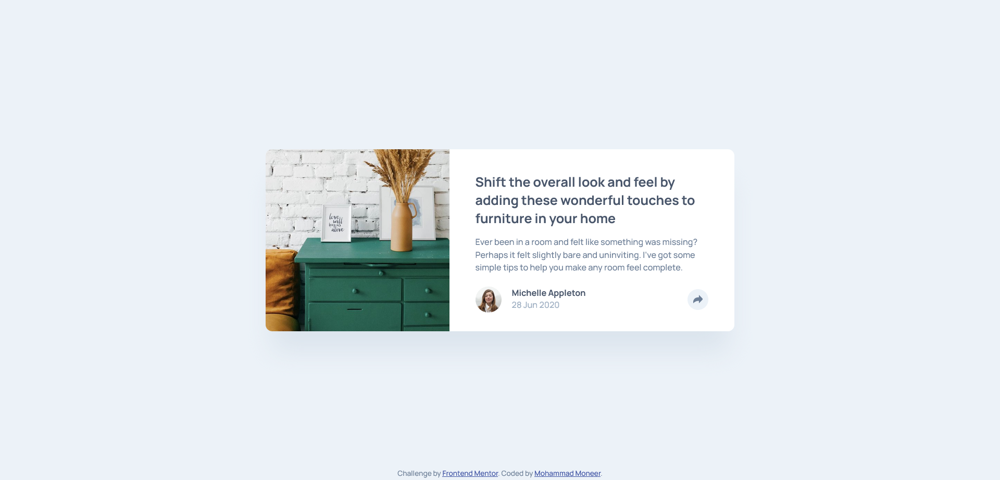
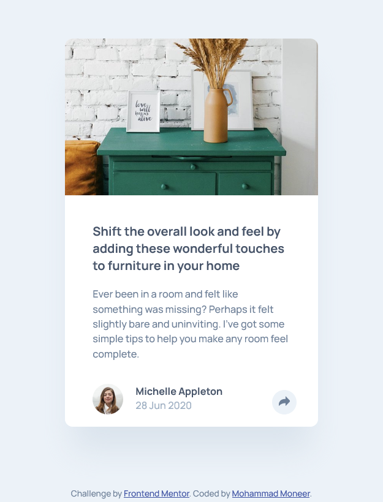

# Frontend Mentor - Article preview component solution

This is a solution to the [Article preview component challenge on Frontend Mentor](https://www.frontendmentor.io/challenges/article-preview-component-dYBN_pYFT). Frontend Mentor challenges help you improve your coding skills by building realistic projects.

## Table of contents

- [Overview](#overview)
  - [Screenshot](#screenshot)
  - [Demo video](#demo-video)
  - [Links](#links)
- [My process](#my-process)
  - [Built with](#built-with)
  - [New Skills and Knowledge Gained from This Project](#new-skills-and-knowledge-gained-from-this-project)
- [Author](#author)

## Overview
To get some details and background of this project visit the link below:
[Frontend Mentor | Article preview component challenge](https://www.frontendmentor.io/challenges/article-preview-component-dYBN_pYFT)

### Screenshot

Desktop version

Mobile version

### Demo video

Desktop version

[desktop-demo.webm](https://github.com/user-attachments/assets/168d1481-c79f-4a3d-a839-2f8b6191972e)

Mobile version

### Links

- [GitHub Repository](https://github.com/Mohammad-Moneer/article-preview-component)
- [Live Demo](https://mohammad-moneer.github.io/article-preview-component/)

## My process

### Built with

- HTML
- CSS
- JavaScript
- Flex
- BEM naming convention

### New Skills and Knowledge Gained from This Project

- **Using `clip-path` with `inset()` to clip an image:** Learned how to control the clipping area by specifying offsets from each edge: `inset(top right bottom left)`.

- **Using inline SVG with `fill="currentColor"`:** Learned how to style SVG icons directly with CSS and make their color inherit the parent's `color` property. This allowed me to dynamically change the share icon's color by toggling a CSS class on the button, without modifying the SVG or using filters.

## Author

- Frontend Mentor - [@Mohammad-Moneer](https://www.frontendmentor.io/profile/Mohammad-Moneer)
